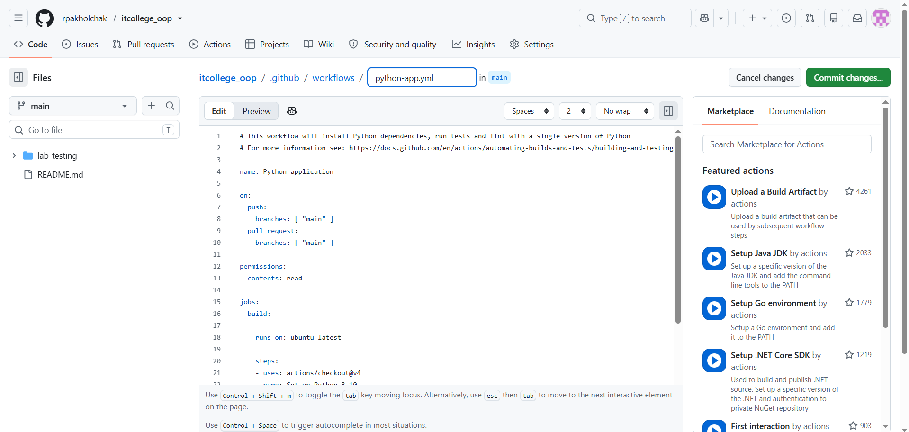
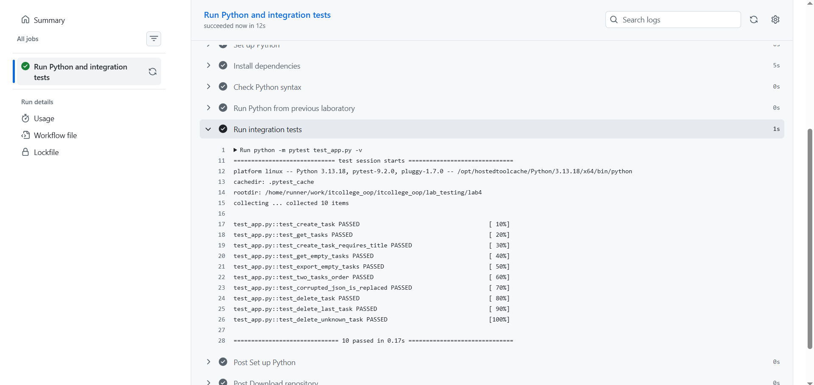
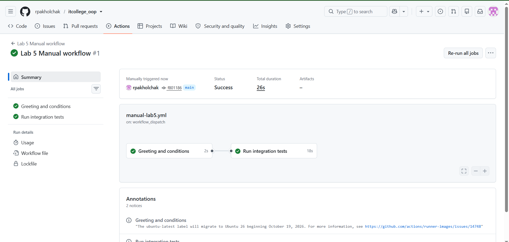
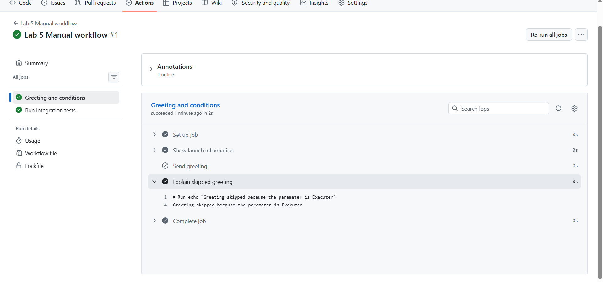
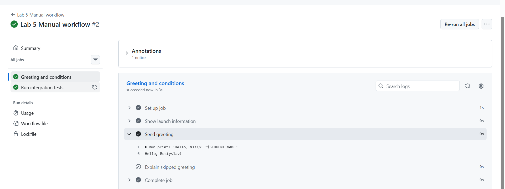
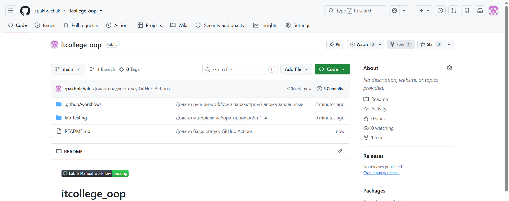
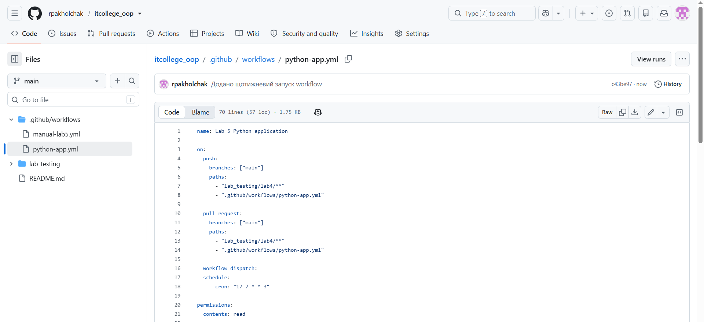
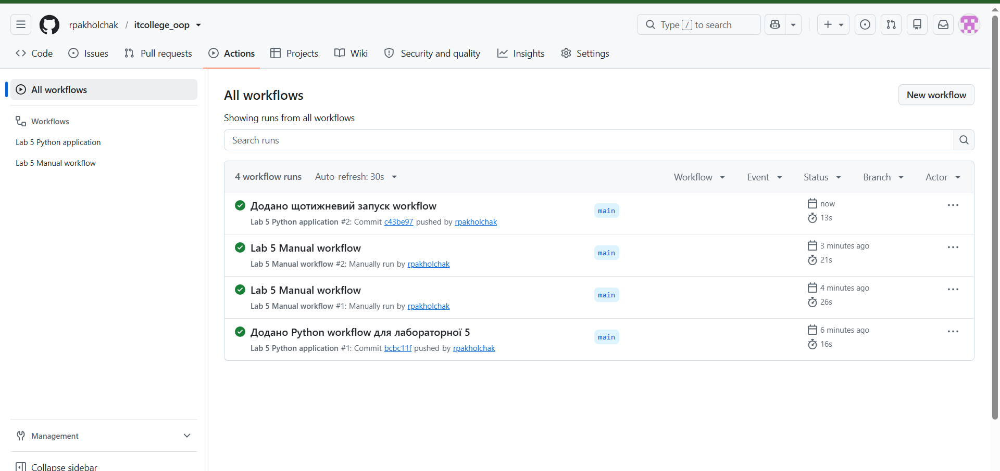

# Лабораторна робота №5
## Автоматизація за допомогою GitHub Actions

**Предмет:** Тестування ПС та К  
**Виконав:** Пахолчак Ростислав Павлович  
**Група:** КН-41

### Мета роботи

Навчитися створювати workflows у GitHub Actions, автоматизувати запуск Python-програми та тестів, використовувати параметри, умови, декілька завдань і розклад cron.

### 1. Створення workflow з шаблону

У репозиторії rpakholchak/itcollege_oop відкрито вкладку Actions та обрано шаблон Python application.

На основі шаблону створено файл `.github/workflows/python-app.yml`. Назву workflow змінено на Lab 5 Python application.

![Шаблон Python application]

Workflow містить такі кроки:

1. Download repository — отримання файлів репозиторію.
2. Set up Python — налаштування Python 3.13.
3. Install dependencies — встановлення Flask і pytest.
4. Check Python syntax — перевірка синтаксису файлів.
5. Run Python from previous laboratory — виконання програми лабораторної №4.
6. Run integration tests — запуск інтеграційних тестів.

Залежності встановлюються командою:

```bash
python -m pip install flask pytest
```

Синтаксис перевіряється командою:

```bash
python -m py_compile lab_testing/lab4/app.py lab_testing/lab4/test_app.py
```

Workflow запускається після push або pull request у main, якщо змінено файли лабораторної №4 або сам файл workflow. Також передбачено ручний запуск через workflow_dispatch.

### 2. Виконання програми та тестів

Для виконання програми використано функцію create_app із лабораторної №4.

У тимчасовій папці створюється SQLite-база. Flask test client виконує GET-запит до `/tasks`. Перевіряються HTTP-статус 200 і порожній список завдань:

```python
response = client.get("/tasks")
assert response.status_code == 200
assert response.get_json() == []
```

Використання тимчасової папки дозволяє виконувати перевірку без зміни робочої бази даних.

Далі з каталогу `lab_testing/lab4` запускаються тести:

```bash
python -m pytest test_app.py -v
```

У першому запуску отримано:

```text
10 passed in 0.17s
```

Перевірено створення, отримання і видалення завдань, валідацію title, порядок записів у базі, порожній список та перезапис пошкодженого JSON-файла.

![Успішне виконання десяти тестів]

### 3. Ручний workflow з параметром

Створено другий файл `.github/workflows/manual-lab5.yml` із назвою Lab 5 Manual workflow.

Для ручного запуску налаштовано параметр student_name:

```yaml
on:
  workflow_dispatch:
    inputs:
      student_name:
        description: "Ім'я для привітання або Executer для пропуску"
        required: true
        default: "Executer"
        type: string
```

Під час натискання Run workflow користувач може залишити значення Executer або вказати власне ім’я.

Параметр передається команді через змінну середовища:

```yaml
env:
  STUDENT_NAME: ${{ inputs.student_name }}
```

### 4. Виконання декількох завдань

Ручний workflow містить два завдання:

- Greeting and conditions — виведення інформації про запуск і перевірка умов;
- Run integration tests — встановлення залежностей та запуск тестів.

Для другого завдання задано:

```yaml
needs: greeting
```

Тому воно запускається після успішного завершення greeting.

Перший ручний запуск завершився зі статусом Success за 26 секунд. Обидва завдання виконано успішно.

![Два успішні завдання]

### 5. Умовне виконання кроків

Для кроку Send greeting використано умову:

```yaml
if: inputs.student_name != 'Executer'
```

Для Explain skipped greeting використано протилежну умову:

```yaml
if: inputs.student_name == 'Executer'
```

Під час першого запуску передано Executer. Крок Send greeting пропущено, а Explain skipped greeting вивів:

```text
Greeting skipped because the parameter is Executer
```

![Пропуск привітання]

Під час другого запуску передано Rostyslav. Крок Send greeting виконався та вивів:

```text
Hello, Rostyslav!
```

Крок Explain skipped greeting було пропущено. Другий ручний запуск завершився успішно за 21 секунду.

![Привітання з переданим ім’ям]

Таким чином, перевірено обидва варіанти виконання умов.

### 6. Бадж статусу

На початку README.md додано бадж ручного workflow:

```markdown
[](https://github.com/rpakholchak/itcollege_oop/actions/workflows/manual-lab5.yml)
```

Бадж відображає passing та містить посилання на сторінку workflow.

![Бадж у README]

### 7. Налаштування розкладу cron

У Python application додано тригер schedule:

```yaml
  workflow_dispatch:

  schedule:
    - cron: "17 7 * * 3"
```

Розклад передбачає виконання щосереди о 07:17 UTC. У листопаді це відповідає 09:17 за київським часом.

Значення полів cron:

- 17 — хвилина;
- 7 — година;
- * — будь-який день місяця;
- * — будь-який місяць;
- 3 — середа.

![Налаштований розклад]

Після збереження конфігурації workflow успішно запустився через подію push. Цей запуск тривав 13 секунд.

На момент підготовки звіту виконання через schedule ще не зафіксовано. Після першого запуску за розкладом секцію schedule потрібно видалити, щоб уникнути повторних запусків.

### 8. Загальні результати

У вкладці Actions відображаються два workflows:

- Lab 5 Python application;
- Lab 5 Manual workflow.

Зафіксовано чотири успішні запуски: два після push і два ручні.

![Список workflows та успішних запусків]

### Висновок

Створено два workflows GitHub Actions у репозиторії itcollege_oop. Автоматизовано перевірку синтаксису, виконання Flask-програми та запуск інтеграційних тестів.

Усі 10 тестів пройшли успішно. Перевірено передачу параметра ручного запуску, виконання та пропуск кроків за умовами, послідовність двох завдань. Додано бадж статусу та налаштовано розклад cron.

Фактичне виконання через schedule залишається окремим пунктом перевірки. Додаткову інтеграцію з Codecov у цій роботі не налаштовано.

### Посилання

- [Репозиторій](https://github.com/rpakholchak/itcollege_oop)
- [Python application](https://github.com/rpakholchak/itcollege_oop/actions/workflows/python-app.yml)
- [Manual workflow](https://github.com/rpakholchak/itcollege_oop/actions/workflows/manual-lab5.yml)